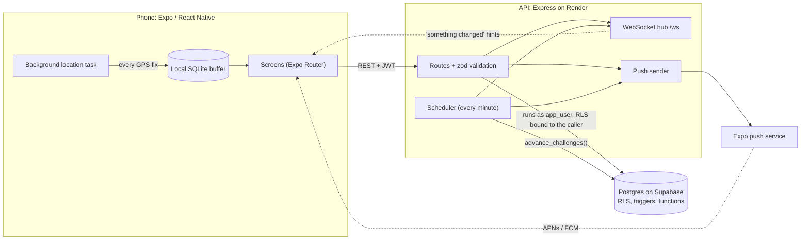
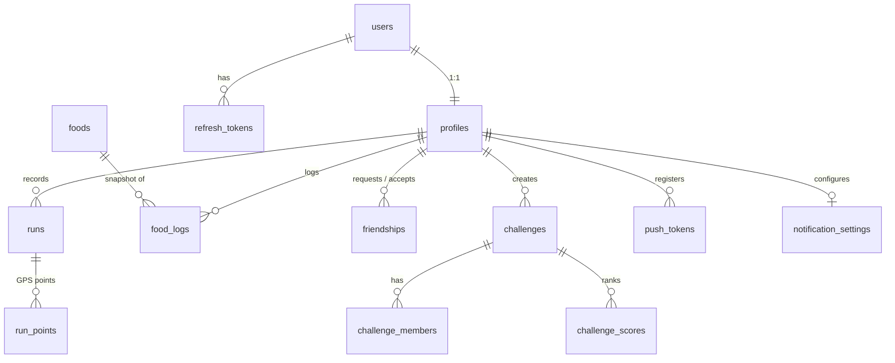

# Asta

**Run, eat, compete.** A cross-platform (iOS + Android) running app with GPS run tracking, calorie logging, friends, and friend challenges with a live leaderboard.

Built with React Native (Expo), TypeScript, an Express API and Postgres. Dark, lime-accented design adapted from a cycling concept to running.

> Screenshots: add yours to [`docs/screenshots/`](docs/screenshots/) and they will show up in the tables below.

| Home | Run | Run detail | Food |
| :-: | :-: | :-: | :-: |
|  |  |  |  |

| Friends | Challenges | Leaderboard | Notifications |
| :-: | :-: | :-: | :-: |
|  |  |  |  |

## Features

- **Run tracking.** Live distance, pace, time and map route. Keeps recording with the screen locked (background location), survives crashes (every GPS fix is saved to the phone first), and uploads when online.
- **History and stats.** Run list with route thumbnails, per-kilometre splits, weekly totals compared with last week, and a bar chart per day, all in the user's own time zone.
- **Food and calories.** English and Arabic search over a starter set of Levantine and everyday foods, custom foods, quick add, an editable day view with a calorie ring and macros, and instant (optimistic) updates.
- **Friends.** Find by exact username or share an invite link, requests, blocking, a friend list with weekly distance, and friend profiles that only ever show a trimmed route.
- **Challenges.** Distance, run-count and calorie-day challenges with invitations, a live leaderboard, tie-breaking by who got there first, and a winner when it ends.
- **Live updates and push.** WebSocket hints refresh badges and leaderboards instantly; push notifications for friend requests, invitations, "someone passed you" and results, each switchable.
- **Platform polish.** Native iOS tab bar with Liquid Glass on iOS 26, skeleton loaders, toasts, haptics, safe areas, keyboard avoidance, screen-reader labels and compact layouts for small phones.

## Architecture



The phone never talks to the database. The API runs every user request as a low-privilege Postgres role (`app_user`) with the caller's id attached, so Row Level Security is a second line of defence behind the route checks.

## Database schema



Migrations are in [`server/migrations/`](server/migrations/) (7 files). Highlights:

- **Privacy by design.** `profiles`, `runs`, `run_points` and `food_logs` are owner-only. Friends read two narrow views (`profile_cards`, `friend_runs`) that expose only a username/avatar and a route with the first and last 200 m cut off. Calories and food never leave the owner.
- **Scores can't be forged.** Clients have no write access to `challenge_scores`; only security-definer triggers do. A `recompute_challenge_scores()` function rebuilds everything from scratch as the source of truth.
- **Server-derived data.** The phone uploads raw GPS points; the server recomputes distance, moving time, splits, routes and calories, so a modified app cannot invent a record.

## How background tracking works

1. When a run starts, the app registers an OS-level **location task** (`expo-location` + `expo-task-manager`). On Android it runs as a **foreground service** with a persistent notification; on iOS it uses background location updates and the blue status-bar indicator.
2. Fixes are delivered by **distance (about every 8 m)**, not by time, so a standing runner produces nothing and the battery lasts.
3. Every fix is written to **SQLite immediately** from the task itself, which touches no screen state, so it keeps working when the UI is gone. Running totals (distance, moving time) live in the same row and are updated in one transaction.
4. Fixes are filtered as they arrive: accuracy worse than 30 m and jumps faster than 12 m/s are dropped; time spent standing still is not counted as moving time; pauses start a new segment so nothing is measured across them.
5. On stop, the raw points are uploaded in one request with a phone-generated id (retries can never duplicate a run). If offline, the run waits in the local queue and uploads later.
6. If the app is killed mid-run, the next start finds the unfinished run and offers **Resume** or **Save what we have**.

**Trade-offs and limits.** Background location needs a development or release build (not Expo Go). Some Android brands kill background apps unless battery optimisation is turned off for Asta. Accuracy depends on the phone's GPS and the sky view; poor fixes are dropped rather than guessed. The server re-checks everything, so the app's own numbers are only a live preview.

## Run it

See [`docs/SETUP.md`](docs/SETUP.md) for the full guide (database, API, app, Render, Google sign-in). In short:

```bash
cd server && npm install && cp .env.example .env   # add DATABASE_URL and JWT_SECRET
npm run migrate && npm run seed:foods && npm run dev
cd .. && npm install && cp .env.example .env.local   # add EXPO_PUBLIC_API_URL
npx expo start --go                                  # quick preview on a phone
```

Building installable apps (Android APK, iPhone TestFlight): [`docs/RELEASE.md`](docs/RELEASE.md). Manual test plan for both platforms: [`docs/QA.md`](docs/QA.md).

## Quality

- **205 server tests** run against a real Postgres engine in-process (no Docker): API behaviour, authentication, privacy rules, challenge scoring at its boundaries, WebSocket delivery and push.
- **64 app unit tests** for the run maths, food maths, history and challenge helpers.
- Strict TypeScript, ESLint and Prettier on both sides: `npx tsc --noEmit && npx expo lint`, and `cd server && npm run typecheck`.

## Roadmap

Not in this version, and the natural next steps:

- **Barcode scanning** for packaged foods (Open Food Facts).
- **Apple Health / Health Connect** sync for runs and calories.
- **Offline-first sync** beyond the run upload queue (food log and challenges while offline).
- **A social feed** of friends' runs with reactions.
- Email verification, password reset, an Arabic translation (the strings are already centralised) and a challenge edit screen.

## Project layout

```
src/            app: routes (src/app), screens by feature (src/features), shared UI, theme tokens
server/         Express API, migrations, tests, seed data
docs/           setup, release and QA guides, design reference
claude-code-prompts.md   the phased build plan this project followed
```
